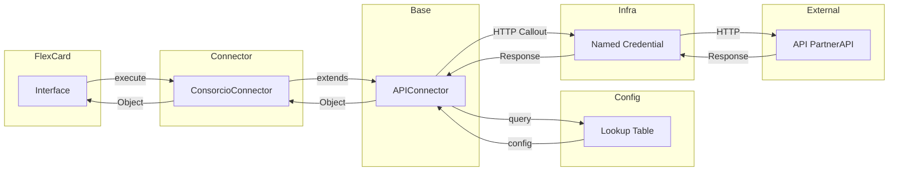
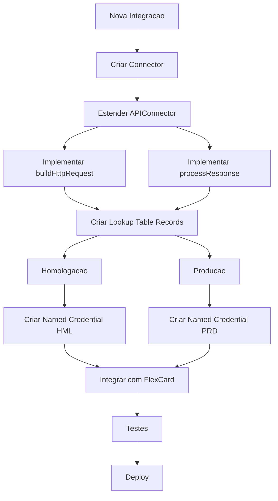

# 04 - Arquitetura de Integracoes (parte 2: resumo, checklist e proximos passos)

Continuacao de `tobe-arquitetura-integracoes.md`.

## Resumo da Arquitetura

```
ARQUITETURA DE REFERENCIA (codigo real, em producao com ACME):
─────────────────────────────────────────────────────────────
BASE (1x, nao mexe):
├── APIConnector.cls
├── APIException.cls
├── APIConfigDAO.cls
└── APIConfigSetup.cls

POR API (ex: ACME):
├── ACMEConnector.cls (+ ACMEConnectorTest.cls)
├── ACME_Sandbox_EC + ACME_Production_EC (External Credentials OAuth2)
├── ACME_Sandbox + ACME_Production (Named Credentials)
└── Linhas na Lookup Table API_Config (1 por operacao x ambiente)

PARA 200 APIS:
──────────────
200 Connectors + linhas de config. Base continua 4 arquivos.
```

---

## Diagrama: Fluxo Completo



---

## Tabela: Componentes por Camada

| Camada | Componentes | Responsabilidade |
|--------|-------------|------------------|
| **Presentation** | FlexCards, OmniScripts, LWC | Interface com o usuario |
| **Integration** | APIConnector, Connectors | Comunicacao HTTP |
| **Configuration** | Lookup Table, Named Credentials | Configuracao por ambiente |
| **Infrastructure** | APIConfigSetup, scripts/*.apex | Setup via codigo + smoke test |

---

## Fluxo de Criacao de Nova Integracao



---

## Checklist: Nova Integracao

- [ ] Criar Connector (extends APIConnector) + operacoes `@AuraEnabled`
- [ ] Implementar buildHttpRequest() + processResponse()
- [ ] Adicionar metodo `call()` (override de ambiente p/ teste manual)
- [ ] Adicionar linhas na Lookup Table via `APIConfigSetup` (nada manual)
- [ ] Criar External Credential + Named Credential (script `setup-<api>-auth.apex`)
- [ ] Preencher client_id/secret + marcar Enabled for Callouts (unico passo UI)
- [ ] Adicionar `classAccesses` + principals no Permission Set `API_Integration` (unico)
- [ ] Criar testes com `HttpCalloutMock` + `APIConfigDAO.mockConfig`
- [ ] Smoke test via `scripts/smoke-<api>.apex` (HML e PRD via `call()`)
- [ ] Integrar com FlexCard/OmniScript (Remote Action no Connector)
- [ ] Deploy + atribuir `API_Integration` ao usuario (detalhe no guia 06)

---

## Vantagens desta Arquitetura

| Vantagem | Descricao |
|----------|-----------|
| **Simplicidade** | 1 classe por API, sem DTOs separados |
| **Risco Zero** | Base testada, extensoes isoladas |
| **Velocidade** | Nova integracao em horas, nao semanas |
| **Manutencao** | Correcoes na base afetam todas |
| **Flexibilidade** | Homologacao e Producao com a mesma classe |
| **Escalabilidade** | Sistema cresce sem limites |
| **Onboarding** | Novos devs aprendem o padrao rapido |

---

## Status e Proximos Passos

**Pronto e validado no org YourOrg (ACME):** base + Lookup Table via codigo +
OAuth2 + 9/9 testes + smoke test fim-a-fim (HML e PRD via `call()`).

Cobertura real: `ACMEConnector` 93%, `APIConnector` 71%, `APIException` 75%, `APIConfigDAO` 24%.

Artefatos criados/deployados estao listados no doc `07-inventario-artefatos.md`.

1. **Secrets + UI:** preencher client_id/secret reais e ligar Enabled for Callouts
   (HML e PRD, 1 tela) — detalhe no `06`, Passo 1.5
2. **Replicar** o padrao para a proxima API seguindo o guia `06-passo-a-passo-nova-api.md`
3. **Padroes de nomenclatura:** `<API>Connector`, `<API>_Homologacao[_EC]`, API_Name = `<API>_Recurso`, Permission Set unico `API_Integration`
4. **Treinar** equipe no guia 06 (procedimento de escala)

### Observacoes de ambiente (importante)

- O auto-detect `Organization.IsSandbox` resolve `Homologacao` em sandbox real e
  `Producao` em producao. A org de validacao FSC reporta `IsSandbox=false`, entao
  `execute()` cai em `Producao`. Para testar os dois ambientes em qualquer org,
  use `call(operacao, params, 'Homologacao'|'Producao')`.
- `API_Integration` e o unico Permission Set das integracoes (todas as APIs).
